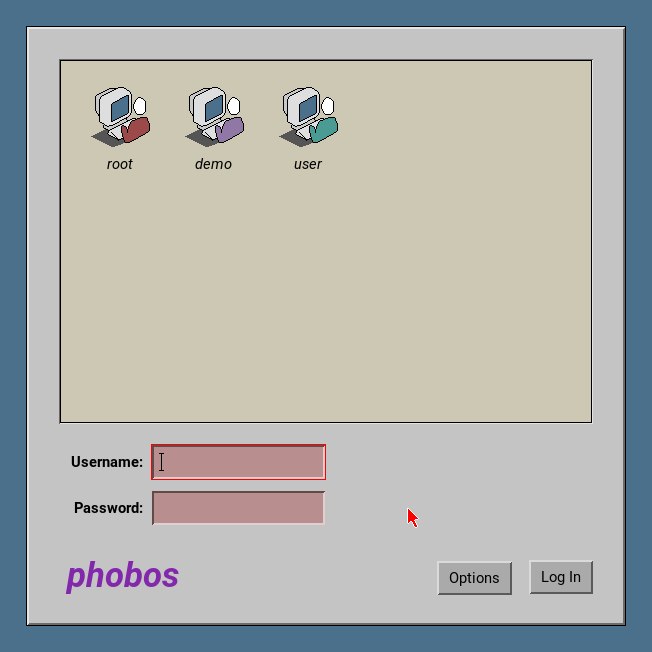

## Login Manager (incomplete)

Experimental IRIX-like login manager for X11 on Linux/Unix. It seems stable enough after using it a few weeks. I am not a security expert.




### Features

- Does PAM authentication.
- Hide or show password.
- Hide or show hostname label.
- Runs a DeskView session (/usr/bin/xmsession).
- Displays user shortcuts (unfinished - hard coded)


### Requirements 

- Motif 2.3.8
- X11/Xlib
- libXinerama
- libXpm
- libXcursor
- libPAM

<br>

### Build Instructions

##### Compile:

```
make clean && make
```

##### Install to /usr/local/bin:

```
make install
```

##### Configure startup services:

To run it at system startup time, try copying 'services/deskview-login.sh' to '/etc/init.d' and then register it with SysVinit:

```
chmod +x /etc/init.d/deskview-login.sh
/sbin/update-rc.d deskview-login.sh defaults
```

##### Uninstall:

```
make uninstall
```

And then manually remove the SysVinit service you added above.

<br>

### Service Management

To start, restart or stop the dvlogin service at runtime:

```
/sbin/service deskview-login.sh start
/sbin/service deskview-login.sh restart
/sbin/service deskview-login.sh stop
/sbin/service deskview-login.sh status
```

For debug purposes you can run it directly without any init service:
```
/usr/local/bin/dvlogin -vt 6
```


#### License

This software is distributed free of charge under the BSD Zero Clause license.
