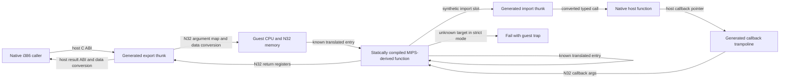

# Compile-time N32 ABI thunks for native i386

Instruction lowering and ABI lowering are related compiler problems, but they
operate at different boundaries. The translated function body can keep the
internal `IrixGuestRuntime *` / `IrixGuestCpu *` convention. Generated thunks
adapt only when execution crosses between that translated world and a native
i386 function. The C compiler can implement the host calling convention for
each typed thunk; generated marshalling code implements N32 placement and data
conversion.

## Call-boundary flow

Translated-to-translated calls do not need a host ABI conversion. Keep those in
the generated dispatcher/CFG path. A known translated target should resolve to
its generated entry. A synthetic import slot should resolve to a generated
import thunk. In strict native mode, an unknown target should trap rather than
silently enter a MIPS interpreter. This is runtime dispatch among prebuilt
native functions, not runtime instruction translation.

## What the build must encode

The SGI N32 ABI handbook specifies eight integer argument registers (`$4..$11`),
eight floating-point argument registers (`$f12..$f19`), 64-bit stack argument
slots, and type-dependent aggregate and return rules. Integer parameters are
promoted to 64-bit register values; pointers remain 32-bit. Prototyped
floating-point arguments can use FP registers even after integer arguments,
while variable arguments use integer argument registers. Results use `$2/$3`
or `$f0/$f2`; small aggregate results have additional register rules. These
details mean the current `uint32_t args[]` helper is a useful smoke-test entry,
not a general N32 ABI adapter. See the [SGI N32 ABI calling-convention
specification](https://pixelbart.net/SGI/IRIX/i/65/30/doc/usr/share/Insight/library/SGI_bookshelves/SGI_Developer/books/Mpro_n32_ABI/sgi_html/ch02.html).

The compile-time API manifest should be keyed by symbol and declaration, and
describe each parameter/result with one of these conversion policies:

| Type/policy | Generated action |
| --- | --- |
| Integer or enum | Apply declared width and signedness; place in N32 integer argument image. |
| Float or double | Place bit-preserving value in the correct N32 FP argument slot when the prototype calls for it; handle varargs separately. |
| Guest pointer to bytes/string | Copy or map into guest address space with an explicit lifetime and direction (in, out, in/out). |
| Opaque handle (`Widget`, `Display`, app context) | Map stable host identity to a guest token and back; never truncate a host pointer. |
| Structure or union | Convert declared fields using N32 size, alignment, and byte order; do not memcpy host layout. |
| Callback | Allocate a stable trampoline, marshal callback arguments in reverse, preserve client data, and manage unregister/lifetime. |
| Variadic call | Use a per-API resource/argument schema; reject unknown resource types instead of guessing from varargs. |

The wrapper's actual C prototype gives the native compiler responsibility for
host i386 argument and result placement. The generator then fills `gpr`, `fpr`,
the N32 stack image, and guest memory from typed host parameters. On return it
checks traps and converts the N32 result registers or hidden aggregate-result
storage back to the declared host type.

## Generation order

1. Build an ABI manifest from the headers and selected exported/imported
   symbols. Header parsing supplies prototypes; annotations supply guest-memory
   layouts, handle identity, callback lifetime, and varargs resource schemas
   where C types alone are insufficient.
2. Generate import thunks for undefined N32 functions and register those at the
   existing synthetic import slots. Generate export thunks for public native
   API names, keeping internal translated function symbols private.
3. Generate callback trampolines and reverse maps for APIs whose callbacks
   cross between host and translated code.
4. Compile the thunks in the same 32-bit build as the translated libraries.
   Preserve a per-call CPU/guest stack or a reentrant call frame; do not share
   mutable argument state across concurrent host calls.
5. Verify every generated boundary has a manifest entry, every import slot is
   resolved to a thunk or an intentional trap, and no strict-mode path reaches
   the MIPS interpreter.

Start with a scalar-only synthetic fixture that checks integer, pointer-token,
and return conversion in both directions. Then use an API with known handle
ownership before adding real Xt resources. Xt varargs and callbacks should be
separate milestones because they need type schemas and lifetime rules beyond
register shuffling.

## Current implementation boundary

`IrixN32Abi.c` provides a tested scalar argument-image packer for the eight N32
argument slots and later big-endian stack slots. `IrixHostAbiContext.c` now
uses it for translated calls and exposes a signature-aware scalar entry point
with integer, pointer, and FP result extraction. It handles integer extension,
32-bit pointers, 64-bit scalars, prototyped FP register placement, and
already-promoted variadic FP values in GPR slots. It deliberately rejects an
unpromoted variadic `float`. Generated host-call/export thunks are still needed
to connect arbitrary native prototypes to this context entry point.

N32 aggregates, typed output pointers, aggregate return conversion, opaque
handle mapping, Xt resource schemas, callbacks, and callback lifetime remain
unimplemented. The current native Xt/Motif wrappers are handwritten and narrow.
Structure, resource, callback, and ownership policies still require explicit
API metadata.

The translated DSOs still depend on `libirixre` guest memory and target
dispatch. This plan moves ABI conversion to build time; it does not by itself
remove that runtime state or make every imported host function available.

## O32 is a separate target profile

An initial source-instruction audit of the O32 Xt/Motif archives in the IRIX
tree found no words rejected by the current N32 semantic decoder:

| O32 archive | Sized function symbols | Instruction words | Rejected by current decoder |
| --- | ---: | ---: | ---: |
| `/usr/lib/libXt.a` | 591 | 54,372 | 0 |
| `/usr/Motif-1.2/lib/libXm.a` | 1,088 | 93,715 | 0 |
| `/usr/lib/abi/libXt.a` | 586 | 48,121 | 0 |
| `/usr/lib/abi/libXm.a` | 1,041 | 87,401 | 0 |

The objects in these archives identify themselves as MIPS I or MIPS II, while
the selected N32 core is N32/MIPS III or later. The zero-rejection result says
the decoder recognizes the words; it does not prove that every word has the
right O32-width semantics or that the O32 object relocations and data layout
are linked correctly.

O32 needs its own ABI profile: four integer argument registers and 32-bit
argument slots, different floating-point argument rules, and O32 aggregate and
return conventions, as contrasted with N32 in the [SGI calling-convention
specification](https://pixelbart.net/SGI/IRIX/i/65/30/doc/usr/share/Insight/library/SGI_bookshelves/SGI_Developer/books/Mpro_n32_ABI/sgi_html/ch02.html).
The current `build_core_stack.py` selects N32 archive
paths; support-object selection filters for `EF_MIPS_ABI2`; and
`irix_host_abi_context_call` uses eight N32 integer argument registers with
8-byte stack slots. So the instruction inventory is a strong starting point,
but O32 libraries and apps are not ready to pass through this native32 path
yet.

The clean extension is to parameterize the build and thunk generator with an
ABI/ISA profile (`n32` versus `o32`) while keeping the i386 code-generation
target unchanged. Then audit and test the O32 closure and use the existing O32
NEdit help path as an integration regression. Preserve the current N32 build
and tests as a separate regression boundary.
