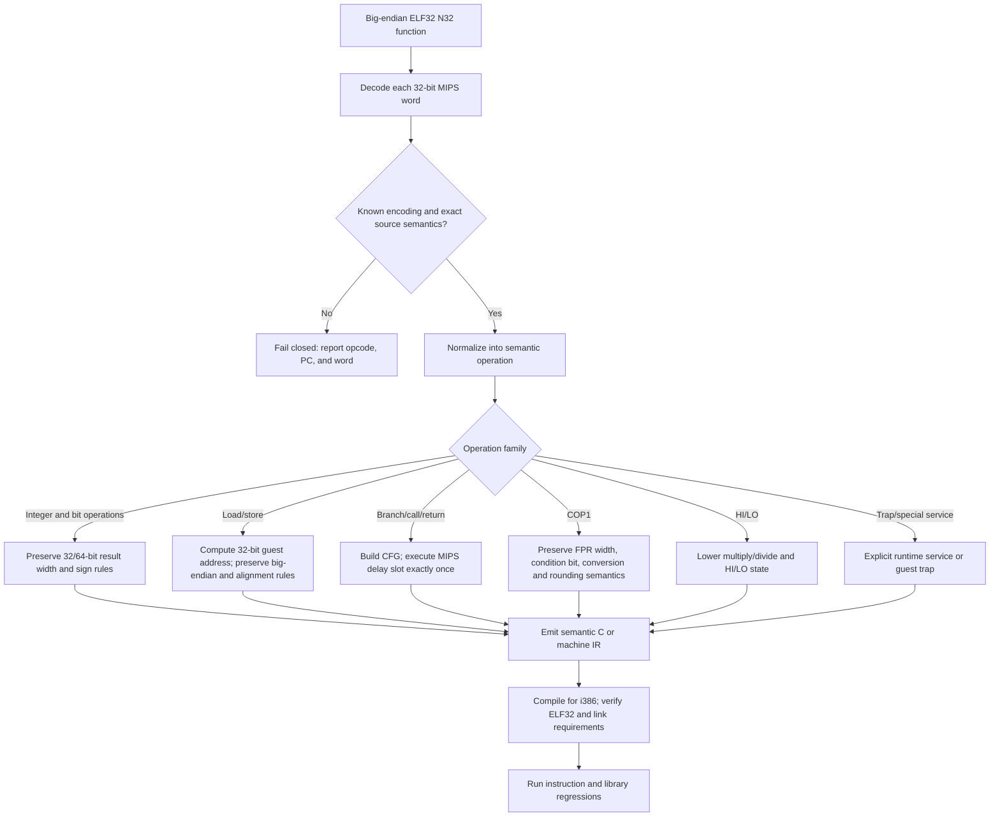

# N32 MIPS to native i386 lowering map

The converter should preserve MIPS *semantics*, not translate mnemonic names
one-for-one. MIPS and i386 share the familiar operation classes—integer
arithmetic, logic, shifts, loads/stores, conditional control flow, calls, and
floating point—but their visible state and execution rules differ. The MIPS64
instruction reference is the authority for source behavior; the Intel SDM is
the authority for the emitted i386 behavior.

## Lowering flow

For a native assembly backend, the `semantic C or machine IR` node becomes a
typed architecture-neutral IR followed by i386 instruction selection and
register allocation. For the existing core path, the C compiler is already the
i386 instruction selector: the N32 decoder emits C with explicit source-width,
sign, and memory semantics, and the native32 build compiles that output with a
32-bit compiler. The small hand-written assembly probe is a backend test; it
does not translate the Xt/Motif functions.

## What carries over and what needs explicit lowering

| Source behavior | Native i386 building block | Required semantic work |
| --- | --- | --- |
| `ADDU`/`SUBU`, `AND`/`OR`/`XOR`, shifts | `add`, `sub`, bitwise ops, shifts | MIPS word results sign-extend to 64-bit GPR state; i386 arithmetic flags are not MIPS-visible state. |
| `SLT`/`SLTU` and conditional branches | `cmp` plus signed/unsigned `setcc` or `jcc` | MIPS comparisons write a GPR; branches have a delay slot, and branch-likely forms annul it when untaken. |
| `LB`/`LW`/`LD`, stores | `mov`/byte operations | Guest addresses are 32-bit; guest data is big-endian while x86 is little-endian. Sign/zero extension and alignment behavior must match the specific MIPS opcode. |
| `LWL`/`LWR`/`SWL`/`SWR`, `LDL`/`LDR` | shifts/masks and byte or word operations | These merge a partial memory operand with an existing register; there is no single equivalent x86 load/store. |
| `J`/`JAL`/`JR`/`JALR` | direct branch, call, indirect branch, return | Preserve the `PC+8` link value, execute the delay slot, and route external or indirect targets through known native entries or an explicit trap/service path. |
| `MULT`/`DIV`, `MFHI`/`MFLO` | i386 multiply/divide plus state | MIPS HI/LO are architectural state; division by zero and signed overflow need exact handling. |
| COP1 arithmetic, loads, compares, conversions | x87/SSE scalar operations or helpers | Preserve FPR bit layout, single/double interpretation, FCR condition state, rounding, NaNs, and conversion edge cases. |
| `SYSCALL`, `BREAK`, privileged/coprocessor state | runtime helper or guest trap | Never map these to a convenient host operation without matching the guest-visible result and fault behavior. |

The architecture-level similarities are useful for instruction selection, but
register count and calling convention do not match: N32 has 64-bit GPR values
and 32-bit pointers, while i386 has eight general-purpose registers and a
32-bit host ABI. A direct native-callable library therefore also needs explicit
N32-to-host ABI wrappers for pointers, structures, callbacks, and varargs.

## Corpus-driven completion rule

“Full set” has two separate meanings. First, the translator must cover every
encoding used by the chosen IRIX library closure. Second, any claim of full
MIPS64 ISA support needs a separate complete ISA inventory; a successful
library build does not imply that unrelated coprocessor, atomic, or privileged
instructions are implemented. The native32 verifier now scans the source-word
comments in generated functions and runs every word through the fail-closed
core decoder. This keeps the work tied to the real libraries and makes a newly
introduced unsupported encoding fail the build.

The generated i386 libraries still use `libirixre` for guest memory and target
dispatch. The ordinary compatibility build can fall back to the interpreter
for an unresolved guest target; the `IRIX_BUILD_NATIVE32_CORE` build instead
emits a guest trap for unsupported control-flow edges and verifies that its
DSOs do not directly call the MIPS interpreter. This is ahead-of-time native
instruction execution, but it is not yet a direct native Xt/Motif link surface:
the generated entry points still use the internal guest-runtime calling
convention. Exporting host-callable functions requires generated ABI wrappers
for pointers, structures, callbacks, and varargs.

### Microline N32-to-i386 validation (2026-10-17)

The five Netscape Microline 3.0 C units (`Grid.c`, `GridUtil.c`, `Tree.c`,
`XmL.c`, and `Folder.c`) compile as N32 MIPS III objects using
`IRIX-TREE/usr/include` plus the full Motif 1.2 development headers from
`holyshit/devl/usr/Motif-1.2/include`. Linking those objects with the Motif and
Xt support archives exercised RELA `R_MIPS_CALL16` and `R_MIPS_GPREL32`; both
are now handled by the N32 stack linker. Translation also exposed `MTHI` and
`MTLO` in `XmLStringDrawDirection`, now handled by the native32 core decoder.

The resulting Microline-plus-support closure translated 4,536 functions with
zero decoder failures and compiled all 184 generated C units as ELF32 i386. The
full native32 core target also rebuilt successfully: 8,455 translated
functions, zero failed functions, and decoder verification of 718,672 source
words across 140 encoding forms. These checks validate the translated runtime
path; they do not yet prove that an unmodified native Netscape executable can
link directly against the generated Motif API.

The ABI conversion can be generated at known call boundaries while keeping
translated-to-translated calls on their internal path. See
[N32_ABI_THUNK_LOWERING.md](N32_ABI_THUNK_LOWERING.md) for the import, export,
callback, and runtime-dispatch map.

## References

- [MIPS64 Architecture for Programmers, Volume II: Instruction Set Reference](https://s3-eu-west-1.amazonaws.com/downloads-mips/documents/MIPS_Architecture_MIPS64_InstructionSet_%20AFP_P_MD00087_06.05.pdf)
- [Intel 64 and IA-32 Architectures Software Developer's Manuals](https://www.intel.com/content/www/us/en/developer/articles/technical/intel-sdm.html)
